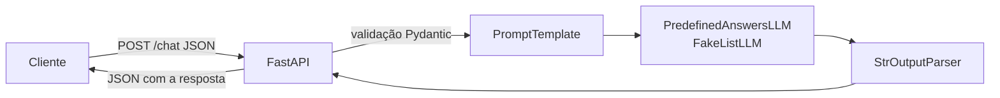

# Chatbot com Fake LLM, LangChain e FastAPI

Protótipo de chatbot que recebe uma mensagem via FastAPI e retorna uma resposta simulada por um Fake LLM do LangChain. O chatbot responde a um conjunto de perguntas pré-definidas e devolve uma resposta padrão para qualquer outra pergunta.

## Por que usar um Fake LLM

- **Rapidez:** a resposta é imediata, sem download de modelos nem chamadas de rede.
- **Custo zero:** não consome créditos de APIs pagas como a OpenAI.
- **Determinismo:** a mesma pergunta sempre gera a mesma resposta, o que torna os testes automatizados confiáveis.
- **Independência:** permite desenvolver e validar a API, os modelos de dados e a chain do LangChain antes de escolher o modelo real.
- **Troca simples:** como o Fake LLM implementa a mesma interface dos LLMs do LangChain, basta substituí-lo por um modelo real na chain sem alterar as rotas.

## Arquitetura



1. O cliente envia a mensagem em JSON para `POST /chat`.
2. O FastAPI valida o corpo da requisição com Pydantic.
3. A mensagem entra na chain do LangChain: `PromptTemplate`, Fake LLM e `StrOutputParser`.
4. O Fake LLM normaliza a pergunta (minúsculas, sem pontuação) e procura a resposta pré-definida. Se não encontrar, usa a resposta padrão.
5. A resposta volta em JSON para o cliente.

## Estrutura

```
.
├── main.py           # criação da aplicação
├── models.py         # modelos Pydantic de requisição e resposta
├── routes.py         # endpoints da API
├── services.py       # Fake LLM, respostas pré-definidas e chain do LangChain
└── requirements.txt
```

## Como executar

```bash
python3 -m venv venv
source venv/bin/activate
pip install -r requirements.txt
uvicorn main:app --reload
```

A documentação interativa fica disponível em http://127.0.0.1:8000/docs.

## Endpoints

| Método | Rota | Descrição |
|--------|------|-----------|
| GET | `/` | Verifica se a API está no ar |
| GET | `/questions` | Lista as perguntas pré-definidas |
| POST | `/chat` | Envia uma mensagem ao chatbot |

### Perguntas pré-definidas

- hello
- what is your name
- what is fastapi
- what is langchain
- what is a fake llm
- how can you help me
- bye

Letras maiúsculas, pontuação e espaços extras são ignorados, então `What is LangChain?` também é reconhecida.

### POST /chat

```bash
curl -X POST http://127.0.0.1:8000/chat \
  -H "Content-Type: application/json" \
  -d '{"message": "What is LangChain?"}'
```

Resposta:

```json
{
  "message": "What is LangChain?",
  "answer": "LangChain is a framework for building applications powered by language models."
}
```
